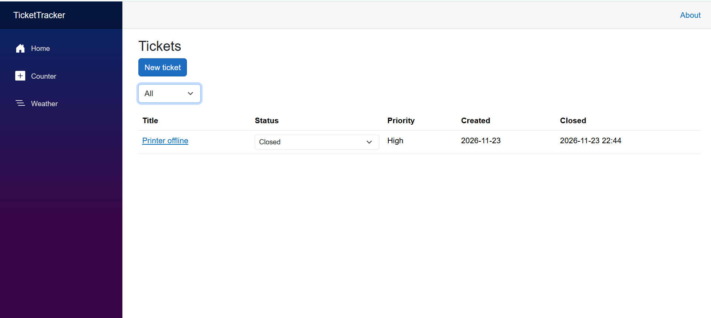
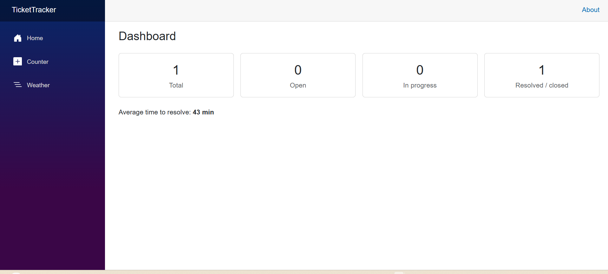

#  Ticket Tracker

# 

# A support ticket tracker built with ASP.NET Core, Blazor, Entity Framework Core, and SQL Server (T-SQL). Personal project: create tickets, move them through a workflow, discuss them in comments, and see live stats from a stored procedure.

# 

# Features

# 

# \- Create tickets with validation (title, description, priority)

# \- Change ticket status from the list; `ClosedAt` is set when a ticket is resolved or closed and cleared when it is reopened

# \- Filter the list by status

# \- Ticket detail page with comments (joined to users)

# \- Dashboard backed by a SQL Server stored procedure (counts and average time to resolve)

# \- xUnit tests for the status/`ClosedAt` rules

# 

# Tech stack

# 

# ASP.NET Core and Blazor (interactive server), C#, Entity Framework Core (Code First migrations), SQL Server LocalDB with T-SQL, xUnit, Git/GitHub.

# 

# \## T-SQL in this repo

# 

# `sql/02\_tsql\_objects.sql` contains, and is safe to re-run:

# 

# \- Indexes on `Tickets (Status)` (with included columns) and `TicketComments (TicketId, CreatedAt)`

# \- `usp\_TicketStats` - dashboard numbers

# \- `usp\_GetTickets` - filtered list with an optional parameter

# \- `vw\_TicketLatestComment` - latest comment per ticket using a CTE and `ROW\_NUMBER()`

# 

# Screenshots

 

 

# \## Run it locally

# 

# Requires the .NET 10 SDK and SQL Server LocalDB (included with Visual Studio).

# 

# 1\. Clone the repo.

# 2\. Check the connection string in `appsettings.json` (defaults to `(localdb)\\MSSQLLocalDB`).

# 3\. Create the database: `dotnet ef database update`

# 4\. Run the T-SQL objects: execute `sql/02\_tsql\_objects.sql` in SQL Server Object Explorer or SSMS.

# 5\. Start the app: `dotnet run`

# 6\. Run the tests: `dotnet test`

# 

# \## Notes

# 

# \- There is no login; the comment form lets you pick one of two seeded users.

# \- Timestamps are stored in UTC.

# \- Built to practice the ASP.NET Core / Blazor / SQL Server stack.

